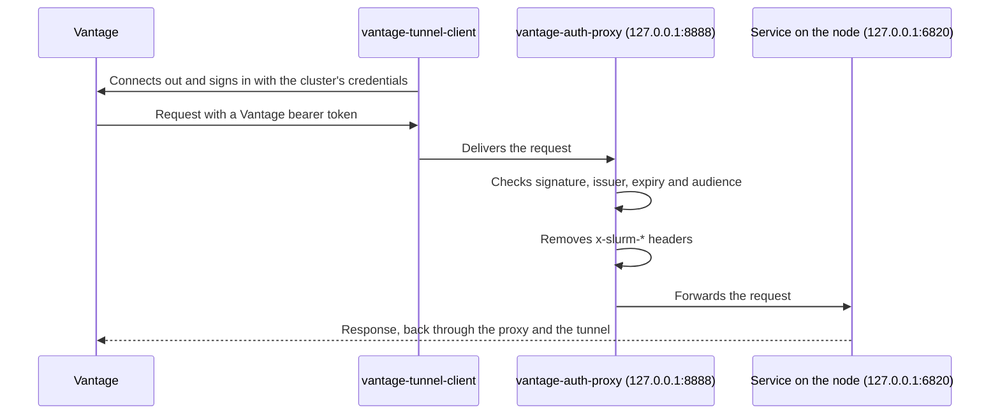
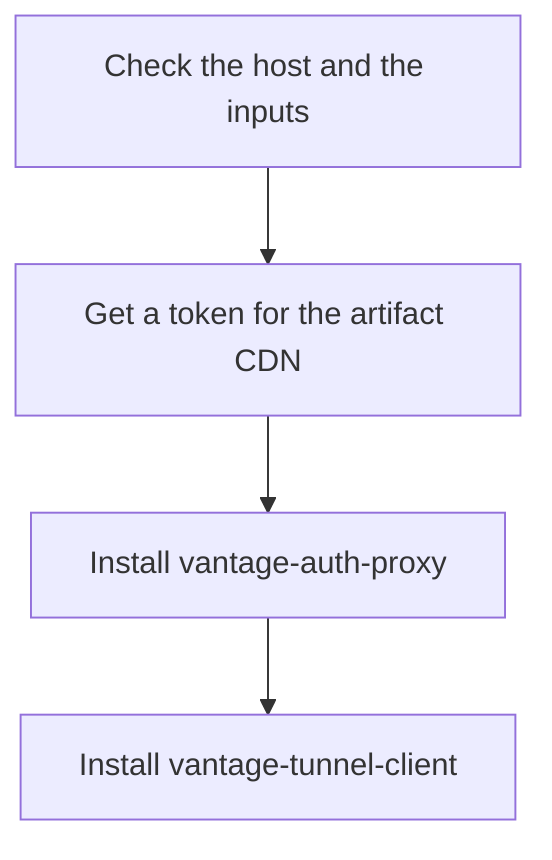

## The path of a request

A request with a missing or invalid token stops at the proxy and never reaches the service.

## The order of work

The proxy comes first, because the tunnel client delivers platform traffic to it.

## Checking the host and the inputs

Before changing anything, the role checks that:

1. The host is Ubuntu 26.04 on x86_64.
2. Every required variable has a value.

It does not check for Slurm or for a service on `127.0.0.1:6820`.

## How each binary is installed

The same steps install both binaries.

1. **Sign in.** The role trades the cluster's client ID and secret for a short-lived Keycloak
   token.
2. **Fetch the checksum.** It downloads `<binary>.sha256` from the artifact CDN with that token.
   The URL is `<artifacts_url>/binaries/<binary>/linux-amd64/<version>/<binary>`.
3. **Download and verify.** It downloads the binary to `/var/cache/vantage-tunnel` and checks it
   against the checksum.
4. **Decide.** It compares the checksum with the binary in `/usr/bin`. When they match, the
   install step is skipped.
5. **Install.** Otherwise it runs the downloaded binary's own `systemd-setup` command, which
   creates the service user, the directories and the unit file, and copies the binary to
   `/usr/bin`.
6. **Record.** It writes one line (name, requested version, sha256) to
   `/etc/vantage/artifacts.lock`. This is the same file and format that `v8x` writes.
7. **Configure.** It writes the settings file, owned by root with mode `0600`.
8. **Start.** It restarts the service once if the binary or the settings changed, then makes sure
   it is enabled and running.

Because step 4 compares checksums, a second run changes nothing, and `latest` reinstalls only when
the CDN serves a new build.

## The image's path units

The Vantage image enables a `.path` unit next to each of these services
(`vantage-auth-proxy.path` and `vantage-tunnel-client.path`). Once a service is installed by its
own `systemd-setup`, the enabled service alone starts it, so the role stops and disables the
image's path unit when it finds one. On a node that is not built from the Vantage image, there is
nothing to turn off and the step is skipped.

## What the settings files contain

`/etc/vantage/vantage-auth-proxy/env`:

| Setting | Value |
|---|---|
| `VANTAGE_AUTHPROXY_CLUSTER` | `vantage_tunnel_cluster_name` |
| `VANTAGE_AUTHPROXY_ISSUER` | `vantage_tunnel_oidc_base_url` followed by `/realms/vantage` |
| `VANTAGE_AUTHPROXY_AUDIENCE` | `vantage_tunnel_client_id` |
| `VANTAGE_AUTHPROXY_LISTEN` | `127.0.0.1:8888` |

`/etc/vantage/vantage-tunnel-client/env`:

| Setting | Value |
|---|---|
| `OIDC_CLIENT_ID` | `vantage_tunnel_client_id` |
| `OIDC_CLIENT_SECRET` | `vantage_tunnel_client_secret` |
| `TUNNEL_CLIENT_VANTAGE_URL` | `vantage_tunnel_vantage_url` |
| `PROXY_FORWARD_HOST` | `localhost` |
| `PROXY_BIND_PORT` | `8888` |

Both files are managed by the role. A change made by hand is overwritten on the next run.

## Files on the node

| Path | Mode | What it is |
|---|---|---|
| `/usr/bin/vantage-auth-proxy`, `/usr/bin/vantage-tunnel-client` | | The binaries |
| `/var/cache/vantage-tunnel/` | `0750` | The downloaded binaries |
| `/etc/vantage/artifacts.lock` | | One line per installed binary |
| `/etc/vantage/vantage-auth-proxy/env` | `0600` | Proxy settings. No secret |
| `/etc/vantage/vantage-tunnel-client/env` | `0600` | Tunnel client settings, including the client secret |
