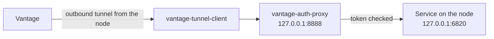

`vantage_tunnel` is an Ansible role that installs the Vantage Compute tunnel client and the
Vantage auth proxy on a node. Together they let Vantage reach a service on that node without an
inbound firewall rule, through a proxy that checks the Vantage token on every request.

It installs two programs, in this order:

| Program | What it does |
|---|---|
| `vantage-auth-proxy` | Listens on `127.0.0.1:8888`. It validates the Keycloak bearer token on every request (signature, issuer, expiry and this cluster's audience), strips inbound `x-slurm-*` headers, and forwards the request to `127.0.0.1:6820` on the same node |
| `vantage-tunnel-client` | Opens an outbound connection from the node to Vantage and delivers platform traffic to the proxy |



The proxy is installed and started first, because the tunnel client delivers traffic to it.

## The node does not have to run Slurm

The role checks only the platform and its own inputs, so it applies to any Ubuntu 26.04 node.

The proxy forwards to `127.0.0.1:6820`, which is where slurmrestd, Slurm's REST API service,
listens by default. That is the usual case: on a Slurm node, this role is what lets Vantage reach
slurmrestd. On a node without Slurm, the two services still install and run, and a request
through the tunnel succeeds only when something listens on that address.

The role is independent of the
[vantage_agents](https://github.com/vantagecompute/ansible-role-vantage_agents) role and can be
applied on its own.

## Quick start

Install the role from Ansible Galaxy:

```bash
ansible-galaxy role install vantagecompute.vantage_tunnel
```

Apply it, with the secret in `ansible-vault`:

```yaml
- hosts: cluster_head
  become: true
  vars:
    vantage_tunnel_client_id: my-cluster
    vantage_tunnel_client_secret: "{{ vault_vantage_client_secret }}"
    vantage_tunnel_cluster_name: my-cluster
    vantage_tunnel_oidc_base_url: https://auth.vantagecompute.ai
    vantage_tunnel_vantage_url: https://app.vantagecompute.ai
  roles:
    - vantagecompute.vantage_tunnel
```

Read [Installation](./installation.md) for what the node needs first, and [Usage](./usage.md) for
pinning versions and upgrading.

## Who applies this role

The Vantage Compute `v8x` command-line tool applies this role, together with `vantage_agents`,
when it deploys the `slurm-single-qemu` application. You can apply the same role to your own
nodes.

## Terms

- **Tunnel**: an outbound connection from the node to Vantage, so Vantage can reach the node
  without an inbound firewall rule.
- **Keycloak and OIDC**: Keycloak is the sign-in service Vantage uses, and OIDC is the protocol it
  speaks. The cluster signs in with a client ID and secret and receives a short-lived token.
- **Bearer token**: the login token a client sends in an `Authorization: Bearer ...` header. The
  proxy checks it before anything reaches the service behind it.
- **Audience**: the cluster named inside a token. The proxy rejects a token whose audience is
  another cluster.
- **x-slurm-* headers**: request headers that tell Slurm which user is calling. The proxy removes
  any it receives, so a caller cannot pretend to be someone else.
- **Loopback**: the address `127.0.0.1`, reachable only from the same machine. The proxy listens
  only there.
- **systemd-setup**: a command each Vantage binary has that installs itself as a systemd service
  (its own user, directories and unit file).
- **ansible-vault**: Ansible's tool for keeping secrets encrypted in a file. `no_log` is the task
  setting that keeps a secret out of Ansible's output.
- **Artifact CDN**: the Vantage download service the binaries come from.
